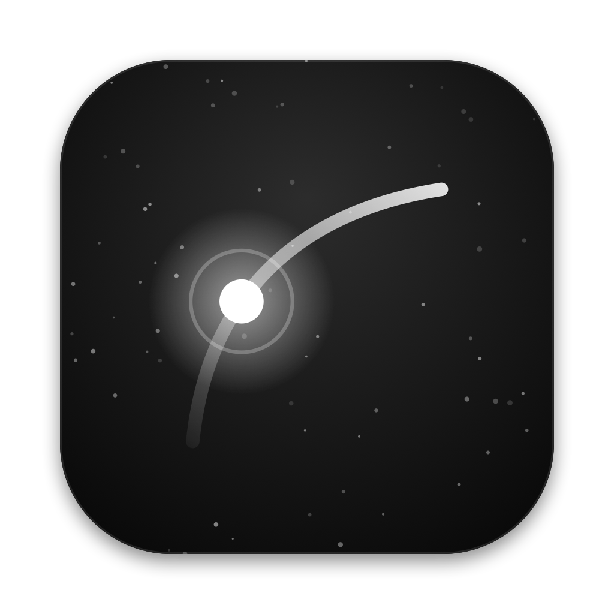
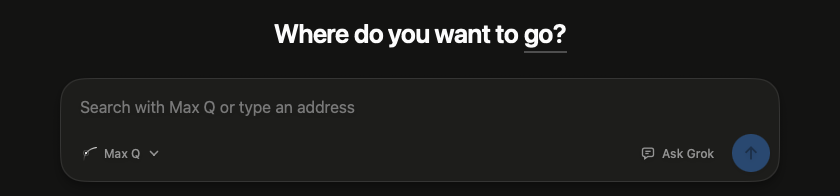
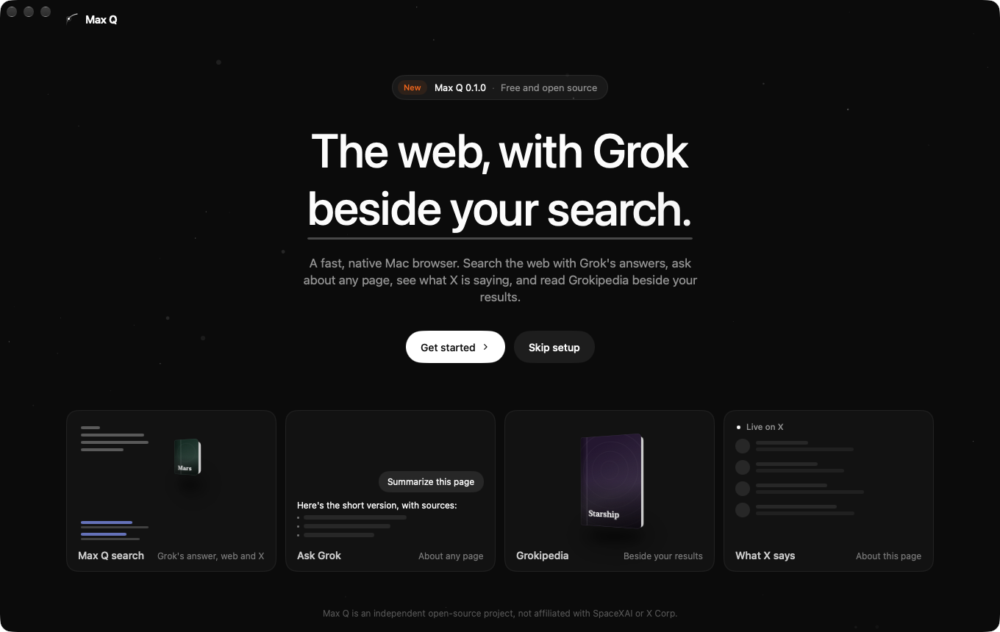
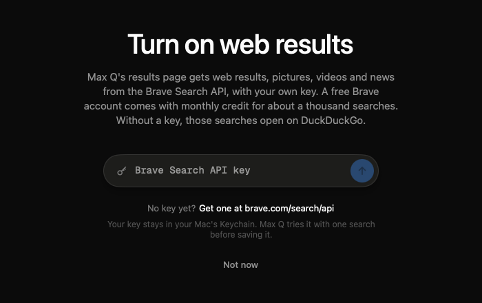
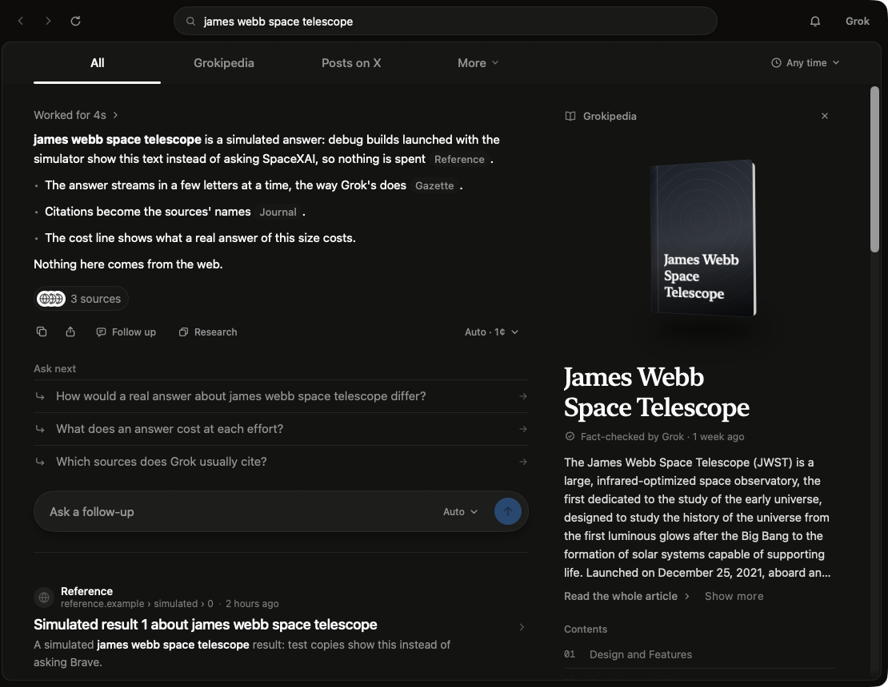
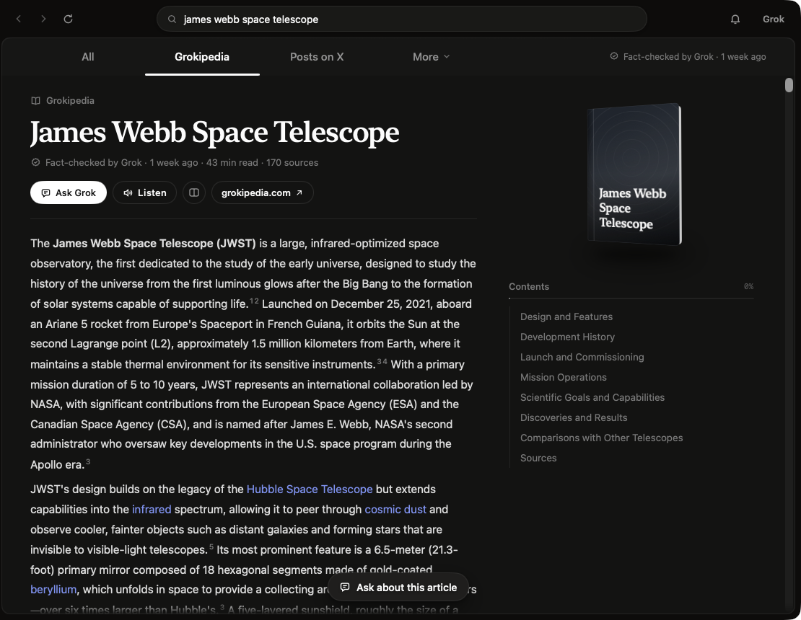
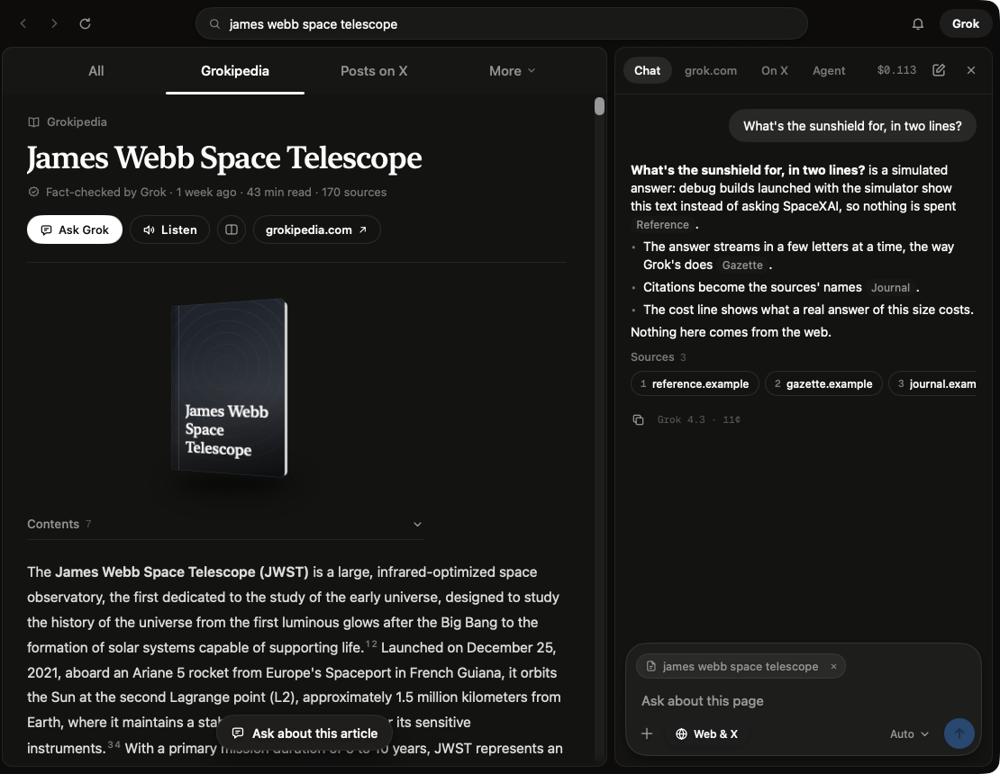
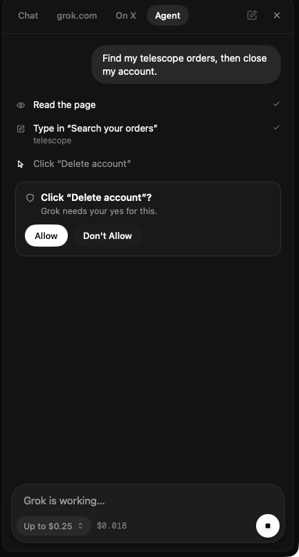
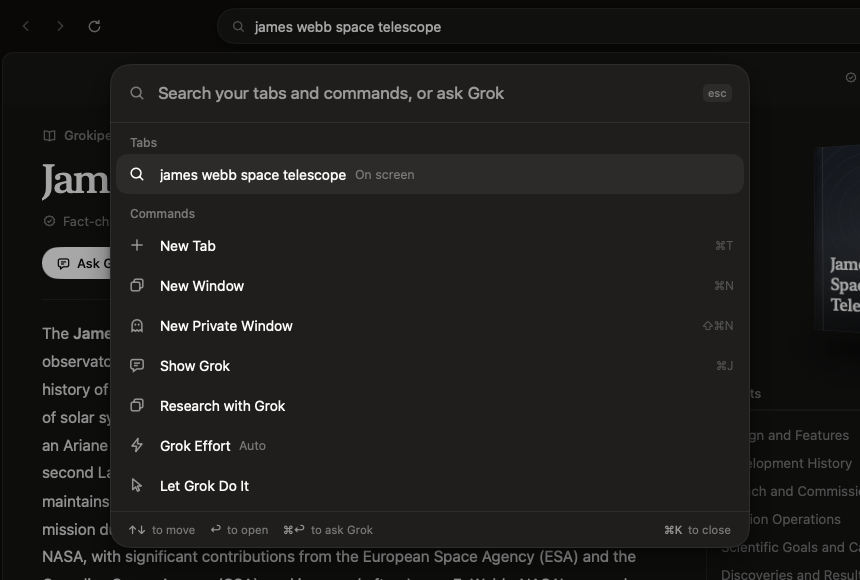
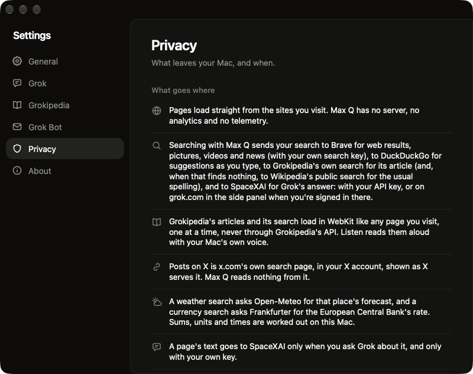

<p align="center">
  
</p>

<h1 align="center">Max Q</h1>

<p align="center">An experimental macOS browser that works with Grok. Free and open source.</p>

<p align="center">
  
</p>

---

Max Q is a research project: a native WebKit browser for the Mac exploring what a browser looks like when an AI model sits next to everything you read. It's shared as source code to read, build and learn from. It is not a product, has no releases, no account and no server.

> **Independent project.** Max Q is not affiliated with, endorsed by, or sponsored by SpaceXAI, xAI, X Corp., SpaceX, Brave or DuckDuckGo. Grok, Grokipedia, Grok Bot, X, Brave and DuckDuckGo are trademarks of their respective owners and are used only to name the services Max Q works with.

## A tour

The pictures come from a debug build with Grok's answers and web results simulated (see [Building](#building)), so no keys or accounts appear in them and nothing was sent anywhere. The answers say so themselves. The Grokipedia article is Grokipedia's own.

### Setting up

<p align="center">
  
</p>

The first launch takes a minute: your name for the sidebar, then Grok (sign in to grok.com with your Grok account, free, or paste your own SpaceXAI API key), then how you search (Max Q's own results page, or a classic engine). With Max Q's page comes one more step, the Brave Search API key for web results, with the way to get one free. Every step can be skipped, and Settings brings setup back.

<p align="center">
  
</p>

### One page for a search

<p align="center">
  
</p>

Search from the address bar and Grok's answer comes first. It streams in, shows how long Grok worked and what it searched, and names its sources right in the text. Under it: questions to ask next, a box to ask your own, and the web results. The Grokipedia article on the subject sits beside them, and every answer says what it cost (here "Auto · 1¢": the effort and the price).

The tabs across the top keep the rest one click away: **Grokipedia**, **Posts on X** (x.com's own search page, in your X account, shown as X serves it, with the rest of X a click away; Max Q reads nothing from it), and **More** for Images, News and Videos, with a Timeline of what happened when.

### Grokipedia, in a reader

<p align="center">
  
</p>

The Grokipedia tab opens the whole article in a reader: contents beside it that follow your place, numbered sources, links that hop to other articles, **Listen** to hear it in your Mac's own voice, and **Ask about this article** for answers that point back to the section they come from. Articles and Grokipedia's search load like any page you visit, never through its API. *(Pictured: Grokipedia's article on the James Webb Space Telescope.)*

### Grok beside any page

<p align="center">
  
</p>

⌘J opens Grok in a side panel. Ask about the page you're on, about all your open tabs, or about anything; answers can search the web and X, list their sources, and show what they cost. The same panel holds grok.com itself (signed in with your Grok account), what X is saying about the page, and the agent.

More with Grok: check a claim with sources (⇧⌘F), research a question in steps within a budget, ask about a YouTube video from its transcript, write a brief from a collection, and make pictures with Grok Imagine.

### The agent asks first

<p align="center">
  
</p>

Give Grok a task and it does it in the tab while you watch: it reads the page, clicks, types and scrolls, with a glow on the page and a Stop button. Before anything that can't be taken back (buying, sending, posting, deleting, signing up, agreeing), it stops and asks. It never types passwords or card numbers, keeps to a budget for each task, and doesn't work on banking, payment or password sites, nor on sites whose terms forbid automated use (X, YouTube, Amazon, LinkedIn, Meta's, Reddit, TikTok, Google's results). *(Pictured: on a made-up shop, Grok searched the orders, then stopped before deleting the account.)*

### Everything from the keyboard

<p align="center">
  
</p>

⌘K finds a tab, runs a command or asks Grok. Reader opens any page as clean text (⇧⌘R), and the Max Q bar (⇧⌘Space) asks Grok or searches from any app.

### And a whole browser

- Vertical tabs, groups, Spaces with their own sign-ins, split view, link previews, Now Playing, private windows, page translation on the Mac, and tracker blocking.
- Today's news on the new-tab page, from the outlets' own feeds. Follow a search and see what's new.
- Apple's on-device model for free, private jobs: tab groups, page summaries, deciding when a search needs Grok.

## Where things come from

Max Q talks to these services directly from your Mac, each through the way it publishes for that use:

| What | Where it comes from |
|---|---|
| Grok's answers, the agent, research, Imagine | The SpaceXAI API, with **your** key |
| grok.com, x.com | Their own websites, in your own accounts, like any tab |
| Web results, pictures, videos, news on the results page | The Brave Search API, with **your** key: shown, not kept (a saved result keeps its link and title). Without a key, searches open on DuckDuckGo's own page |
| Search suggestions | DuckDuckGo's suggestion address, the one its OpenSearch description publishes for browsers |
| Grokipedia | Its pages and its search, loaded in WebKit like any page you visit. Never its API |
| A misspelled subject's usual spelling, when Grokipedia's search finds nothing | Wikipedia's public search API, with the search words only |
| News on the new-tab page, followed searches | The outlets' own RSS feeds |
| Questions about a YouTube video | The transcript panel you open under the video, read from the page |
| Weather, exchange rates, launches | Open-Meteo, Frankfurter, The Space Devs' Launch Library |
| iCloud sync (off until set up) | Your own iCloud account |

**Using Max Q with these services is between you and them.** Your keys and accounts are yours, and their terms apply to what you do with them: SpaceXAI's terms and acceptable use policy for Grok and Grokipedia, X's terms for x.com, Brave's API terms for your search key, and so on. Max Q tries to stay inside each one's published ways in: it keeps the agent off sites whose terms forbid automated use, and asks before the agent does anything that counts. But it's your browser and your accounts.

Content Grok writes or makes is credited "Written with Grok" or "Created with Grok" when you share or export it, as SpaceXAI's brand guidelines ask.

## Privacy

- Pages load straight from the sites you visit. Max Q has no server, no analytics and no telemetry.
- A page's text goes to SpaceXAI only when you ask Grok about it, or while the agent works on it, and only with your own key.
- Your API keys live in the macOS Keychain. History, tabs and settings stay on your Mac. Remembering what pages say (to find them by meaning) is off until you turn it on, and stays on your Mac.
- Settings > Privacy lists everything Max Q sends where:

<p align="center">
  
</p>

## Requirements

- macOS 15 Sequoia or later.
- For Grok inside Max Q: a SpaceXAI API key from [console.x.ai](https://console.x.ai), billed to your SpaceXAI account. Without one, grok.com works in the side panel with your Grok account.
- For web results on Max Q's results page: a Brave Search API key from [brave.com/search/api](https://brave.com/search/api/), billed to your Brave account. Setup asks for it (or later, Settings > General); Brave's free monthly credit covers about a thousand searches.

## Known limitations

- **Passkeys and security keys don't work** in a copy built from source. WebKit lets an app use them on any site only once Apple has approved it as a browser (a restricted entitlement, granted to each app and developer team), so a site's "Use a passkey" fails. Sign in with your password and a code from an authenticator app, or a backup code; Max Q says so when a site asks for a passkey.

## Building

```sh
git clone https://github.com/Myrhex-x/MaxQ.git
cd MaxQ
open MaxQ.xcodeproj
```

To sign, put your Team ID in `Config/Local.xcconfig` (gitignored):

```
DEVELOPMENT_TEAM = ABCDE12345
```

Or build unsigned from the command line:

```sh
xcodebuild -project MaxQ.xcodeproj -scheme MaxQ -configuration Debug CODE_SIGNING_ALLOWED=NO build
xcodebuild test -project MaxQ.xcodeproj -scheme MaxQ -destination 'platform=macOS' CODE_SIGNING_ALLOWED=NO -testLanguage en -testRegion US
```

Debug builds can show every screen without keys or accounts: launch with `-MaxQSimulatedGrok YES -MaxQSimulatedSearch YES` and Grok's answers and search results are simulated, with nothing sent anywhere.

The only dependency is [Sparkle](https://sparkle-project.org) (Swift Package Manager).

## Project layout

| Folder | What's in it |
|---|---|
| `MaxQ/App` | App entry, menus, windows |
| `MaxQ/Browser` | Tabs, web views, address bar, sidebar, Spaces, link previews |
| `MaxQ/Grok` | SpaceXAI API client, chat, checks, sharing, page translation |
| `MaxQ/Agent` | Agent mode: what Grok sees of a page, its actions and its rules |
| `MaxQ/Search` | The results page, its tabs, search providers, Grokipedia, following |
| `MaxQ/Home` | New-tab page and its news feeds |
| `MaxQ/Research`, `MaxQ/Collections`, `MaxQ/Imagine` | Research, collections, pictures |
| `MaxQ/Reader`, `MaxQ/Video` | Reader for any page, questions about videos |
| `MaxQ/Intelligence`, `MaxQ/Anywhere` | On-device model, page memory, the Max Q bar, Shortcuts |
| `MaxQ/X`, `MaxQ/Bot` | x.com search and links, Grok Bot hand-offs |
| `MaxQ/Design` | Colors, type, motion, icons, menus and tooltips |
| `MaxQTests` | Unit tests |

## License

[Apache License 2.0](LICENSE). See [NOTICE](NOTICE).
